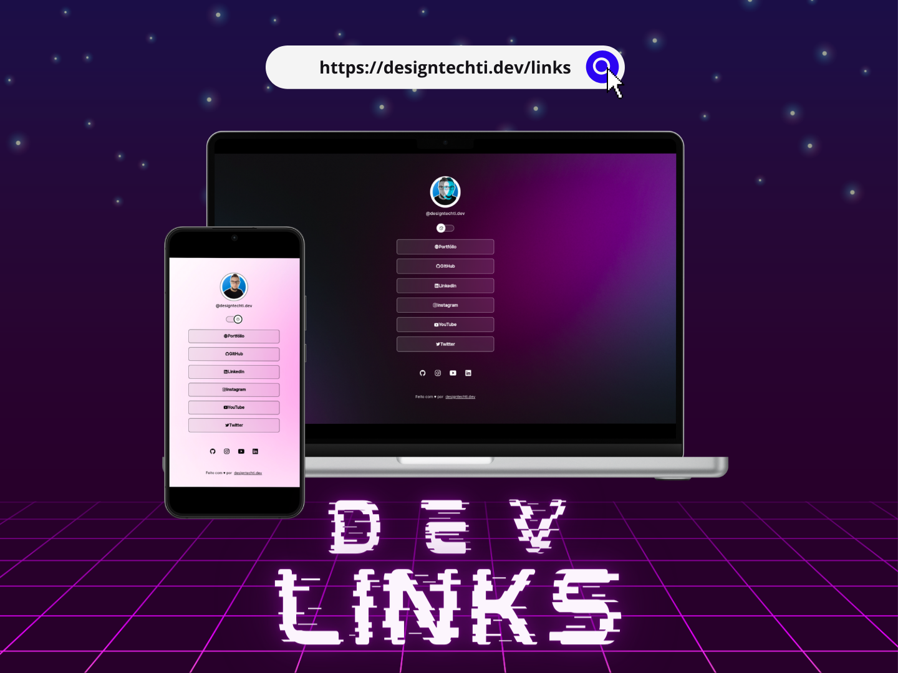

<h1 align="center"> DevLinks </h1>

<p align="center">
  <a href="#-tecnologias">Technologies</a>&nbsp;&nbsp;&nbsp;|&nbsp;&nbsp;&nbsp;
  <a href="#-projeto">Project</a>&nbsp;&nbsp;&nbsp;|&nbsp;&nbsp;&nbsp;
  <a href="#-layout">Layout</a>&nbsp;&nbsp;&nbsp;|&nbsp;&nbsp;&nbsp;
  <a href="#memo-licença">License</a>
</p>

<p align="center">
  
</p>

<br>

<p align="center">
  
</p>

## 🚀 Technologies

This project was developed with the following technologies:

&nbsp;
&nbsp;
&nbsp;
&nbsp;

## 💻 Project

DevLinks is a link aggregator to use as an online business card.

## 🧩 Component structure

The interface is divided into small components. Each component keeps its styles
in a CSS Module (`.module.css`), so class names are scoped to that component.

```text
src/
├── App.tsx
├── App.module.css
├── index.css
└── components/
    ├── Profile/
    │   ├── Profile.tsx
    │   └── Profile.module.css
    ├── Switch/
    │   ├── Switch.tsx
    │   └── Switch.module.css
    ├── Links/
    │   ├── Links.tsx
    │   └── Links.module.css
    └── Footer/
        ├── Footer.tsx
        └── Footer.module.css
```

`App` coordinates the light/dark theme and composes the page. `Profile` displays
the avatar and identity, `Switch` toggles the theme, `Links` contains social
profiles, the video, and link cards, and `Footer` renders the attribution.

To run locally, use `npm install` followed by `npm run dev`. Run `npm run build`
to check TypeScript and create the production build.

## 🔖 Layout

You can view the project layout through [this link](https://www.figma.com/community/file/1187422022288947321). É necessário ter conta no [Figma](https://figma.com) para acessá-lo.

## 📝 License

This project is under the MIT license.

## 👤 Author

<table width="100%">

<tr>

<td align="center">

<a href="https://github.com/designtechti490">


<br />

<sub>

<b>Marcelo Junior</b>
          <i>Front End Developer</i>

</sub>

</a>

</td>

</tr>

</table>

---

Made with 💙 by [designtechti.dev](https://beacons.ai/designtechti.dev) ⌨️
